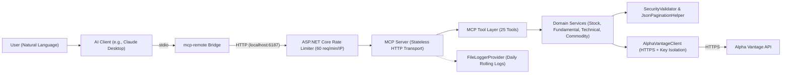

# Stock-Scope: A Production-Ready MCP Server for AI-Powered Financial Analysis

---

Evan Santosa | 2026 | Portfolio Project

### I. Executive Summary

Financial research often requires jumping between stock screeners, earnings calendars, technical charting platforms, and regulatory filings just to answer a single investment question. For non-technical investors and analysts, gathering this data is slow and fragmented; for AI assistants, connecting directly to raw financial APIs often leads to oversized JSON payloads, context-window overflows, and inconsistent data formatting.

**Stock-Scope** bridges this gap by turning any compatible AI assistant (such as Claude Desktop or VS Code Copilot) into a real-time financial research analyst. Built on **ASP.NET Core (.NET 10)** and the official **Model Context Protocol (MCP) C# SDK**, Stock-Scope exposes **25 specialized financial tools** covering live equity quotes, historical price series, corporate fundamentals, insider & Congressional trading disclosures, statistical analytics, technical indicators, and precious metals.

Behind the scenes, Stock-Scope is engineered with production-grade safeguards: strict input validation, per-IP rate limiting, API key isolation, single-line structured logging, and a custom JSON/CSV pagination engine that trims massive financial datasets into clean, AI-friendly slices. The result is a fast, reliable, and self-contained financial intelligence server that anyone can run locally in minutes and query in plain English.

### II. Business Context

AI assistants are increasingly used as first-pass research companions for market analysis, portfolio tracking, and financial due diligence. However, general-purpose LLMs have two fundamental limitations when used for finance:

1. **Stale Training Data:** Without live tool access, models cannot see current stock prices, recent earnings reports, upcoming IPOs, or newly disclosed insider trades.
2. **Unstructured API Friction:** Raw financial data feeds often return thousands of historical records or multi-megabyte financial statements in a single call, overwhelming an LLM's context window and driving up token costs.

By adopting the **Model Context Protocol (MCP)**—an open standard for connecting AI models to external tools and data—Stock-Scope provides a standardized, reusable bridge between natural-language AI interfaces and authoritative market data from Alpha Vantage.

### III. Problem Statement

Connecting AI assistants to live financial data introduces three core engineering and usability challenges:

- **Context-Window Overflow:** Unfiltered daily price histories or multi-year financial statements can easily exceed model token limits, causing truncated answers or failed requests.
- **Security & Abuse Exposure:** Exposing an external API key through an AI-accessible server risks key leakage in logs/errors, parameter injection, and unbounded request bursts.
- **Fragmented User Experience:** Non-technical users should not have to learn API query syntax, ticker formatting rules, or CSV parsing just to ask _"How has Apple's RSI trended this month compared to its 20-day moving average?"_

Stock-Scope solves these problems by decoupling natural-language reasoning (handled by the AI client) from deterministic data fetching, validation, and pagination (handled by the ASP.NET Core MCP server).

### IV. Project Objectives

1. **Natural-Language Financial Research:** Enable users to query stocks, fundamentals, commodities, and technical indicators conversationally through any MCP-compatible AI client.
2. **Comprehensive Market Coverage:** Provide 25 modular tools spanning market quotes, time series, corporate financials, alternative disclosures (insider & STOCK Act Congress trades), statistical analytics, and technical indicators.
3. **Token-Efficient Data Delivery:** Automatically filter by date range and paginate time-series, array, financial statement, and CSV payloads so AI models receive only the relevant slice of data.
4. **Defense-in-Depth Security:** Enforce strict regex-based input validation, prevent API key leakage in logs/exceptions, lock down external base URLs to HTTPS, and apply fixed-window rate limiting.
5. **Zero-Friction Local & Portable Deployment:** Support simple local execution via `dotnet run` as well as self-contained single-file builds across Windows, macOS, and Linux.

### V. Requirements

#### A. Functional Requirements

| ID    | Requirement              | Description                                                                                                                               |
| ----- | ------------------------ | ----------------------------------------------------------------------------------------------------------------------------------------- |
| FR-01 | Market Quotes & Search   | Retrieve real-time stock quotes, search company tickers by keyword, and check global exchange open/closed status.                         |
| FR-02 | Historical Time Series   | Fetch daily, weekly, and monthly OHLCV data with `YYYY-MM-DD` date filtering and pagination.                                              |
| FR-03 | Market Movers & Activity | Retrieve top US market gainers, losers, and most actively traded tickers.                                                                 |
| FR-04 | Alternative Disclosures  | Query corporate insider trading transactions and US Congressional STOCK Act disclosures by ticker or BioGuide ID.                         |
| FR-05 | Quantitative Analytics   | Compute fixed-window and sliding-window statistics (e.g., `MEAN`, `STDDEV`, `VARIANCE`, `CUMULATIVE_RETURN`).                             |
| FR-06 | Corporate Fundamentals   | Retrieve income statements, balance sheets, cash flows, shares outstanding, EPS history, estimates, dividends, splits, and IPO calendars. |
| FR-07 | Technical Indicators     | Calculate `SMA`, `EMA`, `STOCH` (%K/%D), and `RSI` across intraday, daily, weekly, and monthly intervals.                                 |
| FR-08 | Precious Metals History  | Retrieve historical price series for Gold (`GOLD`/`XAU`) and Silver (`SILVER`/`XAG`).                                                     |

#### B. Non-Functional Requirements

| Category         | Requirement                                                                                                                 |
| ---------------- | --------------------------------------------------------------------------------------------------------------------------- |
| Security         | Validate all inputs via compiled regexes, enforce HTTPS for upstream calls, and scrub API keys from logs/errors.            |
| Reliability      | Apply a 30-second HTTP timeout, handle upstream API error payloads gracefully, and enforce per-IP rate limiting.            |
| Token Efficiency | Clamp pagination limits (`1–100` for series/arrays, `1–50` for financial reports) and include pagination metadata.          |
| Observability    | Emit single-line console, debug, and daily rolling file logs (`logs/stockscope-YYYY-MM-DD.log`) resistant to log injection. |
| Maintainability  | Separate MCP tool definitions, domain services, HTTP clients, configuration, and shared helpers cleanly.                    |
| Portability      | Support stateless HTTP MCP transport and self-contained single-file publishing across `win`, `osx`, and `linux`.            |

### VI. System Design

Stock-Scope runs as a stateless HTTP MCP server built on ASP.NET Core. Clients like Claude Desktop connect to the local server via `mcp-remote`, which translates standard MCP stdio communication into HTTP requests against `http://localhost:6187`.



### VII. Tooling & Capabilities

Stock-Scope automatically discovers and registers **25 MCP tools** organized into four domain modules:

#### A. Equities, Disclosures & Quantitative Analytics (`StockTools`)

| Tool Name                   | What It Does (Plain English)                                                                                                |
| --------------------------- | --------------------------------------------------------------------------------------------------------------------------- |
| `GetStockQuote`             | Gets the latest price, change, and trading volume for a stock ticker (e.g., `AAPL`, `MSFT`).                                |
| `GetDailyTimeSeries`        | Fetches daily open, high, low, close, and volume history with date filtering and pagination.                                |
| `GetWeeklyTimeSeries`       | Fetches weekly historical price and volume data with date filtering and pagination.                                         |
| `GetMonthlyTimeSeries`      | Fetches monthly historical price and volume data with date filtering and pagination.                                        |
| `SearchSymbol`              | Finds matching ticker symbols, company names, and currencies from a keyword search.                                         |
| `GetMarketStatus`           | Checks whether major global stock exchanges are currently open, closed, or in pre/post-market.                              |
| `GetTopGainersLosers`       | Lists top US market gainers, top losers, and most actively traded stocks.                                                   |
| `GetInsiderTransactions`    | Tracks corporate insider buys and sells for a given company.                                                                |
| `GetCongressTrades`         | Retrieves US Congressional stock trades disclosed under the STOCK Act (by ticker or BioGuide ID).                           |
| `GetAnalyticsFixedWindow`   | Computes statistical metrics (`MEAN`, `STDDEV`, `VARIANCE`, `SKEWNESS`, `KURTOSIS`, `CUMULATIVE_RETURN`) over a date range. |
| `GetAnalyticsSlidingWindow` | Computes rolling statistical metrics over a moving lookback window (e.g., 20-day rolling volatility).                       |

#### B. Corporate Fundamentals & Events (`FundamentalTools`)

| Tool Name              | What It Does (Plain English)                                                          |
| ---------------------- | ------------------------------------------------------------------------------------- |
| `GetDividends`         | Retrieves historical and declared dividend payouts with date filtering.               |
| `GetSplits`            | Retrieves historical stock split events.                                              |
| `GetIncomeStatement`   | Fetches annual and quarterly revenue, gross profit, operating income, and net income. |
| `GetBalanceSheet`      | Fetches annual and quarterly assets, liabilities, and shareholder equity.             |
| `GetCashFlow`          | Fetches annual and quarterly operating, investing, and financing cash flows.          |
| `GetSharesOutstanding` | Tracks quarterly basic and diluted share counts over time.                            |
| `GetEarnings`          | Retrieves historical annual and quarterly Earnings Per Share (EPS) performance.       |
| `GetEarningsEstimates` | Fetches analyst consensus earnings estimates and forward projections.                 |
| `GetIpoCalendar`       | Lists upcoming IPOs scheduled over the next 3 months with optional keyword search.    |

#### C. Technical Indicators (`TechnicalIndicatorTools`)

| Tool Name  | What It Does (Plain English)                                                               |
| ---------- | ------------------------------------------------------------------------------------------ |
| `GetSma`   | Calculates the Simple Moving Average (SMA) for trend analysis (e.g., 20, 50, or 200-day).  |
| `GetEma`   | Calculates the Exponential Moving Average (EMA), weighting recent prices more heavily.     |
| `GetStoch` | Calculates the Stochastic Oscillator (`%K` and `%D`) to spot overbought/oversold momentum. |
| `GetRsi`   | Calculates the Relative Strength Index (RSI) momentum oscillator.                          |

#### D. Commodities (`CommodityTools`)

| Tool Name              | What It Does (Plain English)                                                               |
| ---------------------- | ------------------------------------------------------------------------------------------ |
| `GetGoldSilverHistory` | Retrieves daily, weekly, or monthly historical prices for Gold (`XAU`) and Silver (`XAG`). |

### VIII. Implementation

#### A. Clean Layered Architecture

The codebase (`stock-scope/`) follows a strict separation of concerns using ASP.NET Core dependency injection:

- **Tools (`Tools/`):** Thin `[McpServerToolType]` classes (`StockTools`, `FundamentalTools`, `TechnicalIndicatorTools`, `CommodityTools`) with descriptive `[Description]` attributes so LLMs know exactly when and how to invoke each tool.
- **Services (`Services/` & `Services/Interfaces/`):** Scoped business services (`StockService`, `FundamentalService`, `TechnicalIndicatorService`, `CommodityService`) that validate inputs, call the upstream client, and apply pagination.
- **Clients (`Clients/`):** `AlphaVantageClient` encapsulates all external HTTP communication, injects `function` and `apikey` parameters last to prevent parameter tampering, enforces a 30-second timeout, and logs request latency.
- **Configuration (`Configurations/`):** Strongly typed `AlphaVantageConfiguration` bound to the `ALPHA_VANTAGE` configuration section.

#### B. Security & Input Validation

- **Compiled Regex Validation (`SecurityValidator`):** Every user/LLM-supplied parameter is validated before an external request is made—ticker symbols (`^[A-Za-z0-9.\-]{1,20}$`), Congressional BioGuide IDs (`^[A-Z][0-9]{6}$`), strict `YYYY-MM-DD` date formats, valid date ordering, allowed intervals/series types, and sanitized search keywords with control characters stripped.
- **Rate Limiting:** The `/mcp` endpoint is protected by an ASP.NET Core fixed-window rate limiter (`60` requests per minute per client IP, returning HTTP `429 Too Many Requests` when exceeded).
- **Secret Protection:** `AlphaVantageClient` strips the configured API key from exception messages before logging, and `Program.cs` enforces that `ALPHA_VANTAGE:BaseUrl` uses HTTPS.

#### C. Token-Efficient Pagination (`JsonPaginationHelper`)

Financial APIs frequently return hundreds of rows or decades of history. `JsonPaginationHelper` intercepts raw Alpha Vantage responses and applies:

- **Date-Range Filtering & Slicing** for time-series objects (`PaginateTimeSeries`) and JSON arrays (`PaginateArray`), returning structured `pagination` metadata (`page`, `limit`, `totalItems`, `totalPages`, `hasMore`).
- **Report Trimming** (`PaginateFinancialReports`) to cap annual/quarterly financial statements and earnings arrays.
- **CSV-to-JSON Conversion** (`PaginateCsv`) for endpoints like the IPO calendar, converting raw CSV rows into filtered, paginated JSON objects.

#### D. Observability & Logging (`FileLoggerProvider`)

Stock-Scope logs to the console, debug output, and a thread-safe daily rolling file logger under `logs/stockscope-yyyy-MM-dd.log`. All log messages and exception strings have `\r` and `\n` replaced with spaces to prevent log injection.

### IX. Local Setup & MCP Configuration

Follow these steps to run Stock-Scope on your machine and connect it to an AI client such as Claude Desktop.

#### 1. Prerequisites

- [.NET 10 SDK](https://dotnet.microsoft.com/download)
- [Node.js](https://nodejs.org/) (provides `npx`, used by `mcp-remote` to connect stdio-based AI clients to the local HTTP MCP server)
- A free [Alpha Vantage API Key](https://www.alphavantage.co/support/#api-key)

#### 2. Clone the Repository

```bash
git clone https://github.com/xTorch8/stock-scope.git
cd stock-scope/stock-scope
```

#### 3. Configure Your Alpha Vantage API Key

Copy `appsettings.json.example` to `appsettings.json` inside `stock-scope/`:

```bash
cp appsettings.json.example appsettings.json
```

\__(On Windows PowerShell, you can use `Copy-Item appsettings.json.example appsettings.json`.)_

Open `appsettings.json` and replace `YOUR_ALPHA_VANTAGE_API_KEY` with your Alpha Vantage API key:

```json
{
	"Logging": {
		"LogLevel": {
			"Default": "Information",
			"Microsoft.AspNetCore": "Warning",
			"System.Net.Http.HttpClient": "Warning"
		}
	},
	"ALPHA_VANTAGE": {
		"ApiKey": "YOUR_ALPHA_VANTAGE_API_KEY",
		"BaseUrl": "https://www.alphavantage.co/query"
	}
}
```

#### 4. Run the MCP Server Locally

Start the ASP.NET Core server using the `http` launch profile (which listens on `http://localhost:6187`):

```bash
dotnet run --launch-profile http
```

You should see the server start and listen on `http://localhost:6187`. Leave this terminal running while using your AI client.

#### 5. Connect to Claude Desktop (or Any MCP Client)

Open your MCP client configuration file (for Claude Desktop on Windows, `%APPDATA%\Claude\claude_desktop_config.json`; on macOS, `~/Library/Application Support/Claude/claude_desktop_config.json`) and add the `stock-scope` server:

```json
{
	"mcpServers": {
		"stock-scope": {
			"command": "npx",
			"args": ["-y", "mcp-remote", "http://localhost:6187", "--http-only"]
		}
	}
}
```

Restart your AI client to load the new configuration.

#### 6. Try Asking Questions in Plain English

Once connected, you can ask your AI assistant questions like:

- _"What is the current stock quote for AAPL, and how did its 14-day RSI look over the last 30 days?"_
- _"Compare the latest annual income statements and cash flows for MSFT and GOOGL."_
- _"Are there any recent insider transactions for NVDA, or any Congressional trades in semiconductor stocks?"_
- _"Show me the top US market gainers today and any upcoming IPOs."_
- _"How have gold prices moved monthly over the past year?"_

### X. Conclusion

Stock-Scope demonstrates how modern .NET backend engineering and the Model Context Protocol can turn complex, raw financial APIs into a safe, conversational, and reliable AI research assistant. By combining a clean layered ASP.NET Core architecture with strict input validation, per-IP rate limiting, secret-safe logging, and token-efficient pagination, the project delivers both an approachable experience for non-technical users and a production-minded reference implementation for AI tool servers.
